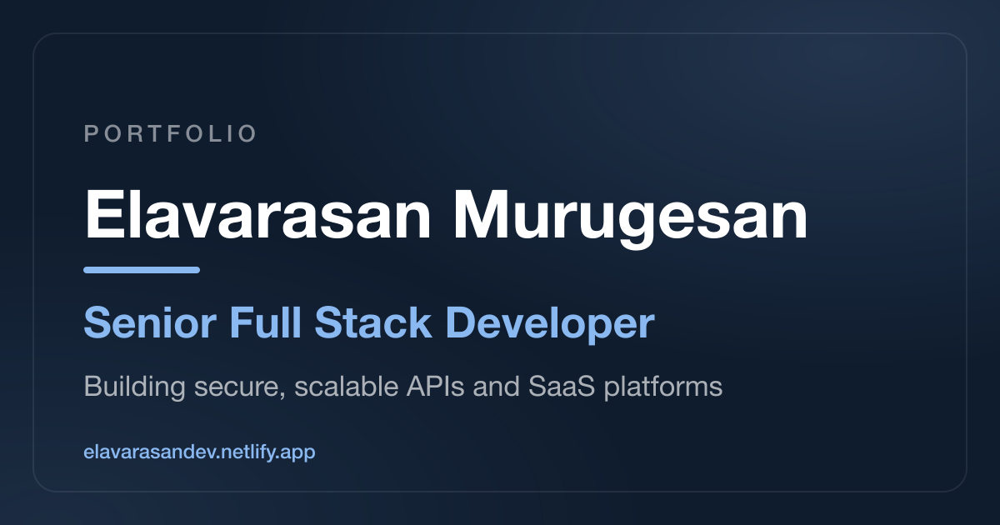

# Elavarasan Murugesan — Portfolio

Personal portfolio of **Elavarasan Murugesan**, Senior Full Stack Developer building secure, scalable APIs and SaaS platforms with NestJS, Node.js, React and React Native.

**Live site:** [elavarasandev.netlify.app](https://elavarasandev.netlify.app)



## Features

- **Sections:** Hero, About, Experience timeline, Projects (with a featured project), GitHub activity, Tech Stack, Achievements & Certifications, Contact
- **Light and dark themes** — follows the system setting by default; the navbar toggle remembers your choice
- **Live GitHub data** — contribution graph and latest repositories, fetched in the browser
- **Navbar that tracks your position** — highlights the section you're reading
- **Responsive** — tested at phone (375px), tablet and desktop widths
- **Accessible** — keyboard focus styles, skip link, descriptive alt text, WCAG AA colour contrast in both themes, reduced-motion support
- **SEO ready** — Open Graph and Twitter card image, metadata and web manifest

## Tech stack

- [Next.js 16](https://nextjs.org/) (App Router, statically prerendered)
- [React 19](https://react.dev/) and TypeScript 6
- [styled-components](https://styled-components.com/) with CSS variables for theming
- `next/font` (Space Grotesk, Inter, JetBrains Mono) and `next/image`
- [Lucide](https://lucide.dev/) and [React Icons](https://react-icons.github.io/react-icons/)
- Deployed on [Netlify](https://www.netlify.com/)

## Getting started

Requires **Node.js 20.9 or later**.

```bash
npm install
npm run dev
```

Open [http://localhost:3000](http://localhost:3000).

| Command         | What it does                         |
| --------------- | ------------------------------------ |
| `npm run dev`   | Start the development server         |
| `npm run build` | Create a production build            |
| `npm run start` | Serve the production build locally   |

## Editing the content

Most content lives in one file, so updating the site rarely means touching components.

| What to change                                                       | Where                                                            |
| -------------------------------------------------------------------- | ---------------------------------------------------------------- |
| Projects, experience, tech stack, achievements, stats, certifications | [`src/constants/constants.ts`](src/constants/constants.ts)       |
| Hero text, buttons and resume link                                   | [`src/components/Home/index.tsx`](src/components/Home/index.tsx) |
| About text                                                           | [`src/components/About/index.tsx`](src/components/About/index.tsx) |
| Contact text and links                                               | [`src/components/Contact/index.tsx`](src/components/Contact/index.tsx) |
| Navbar links                                                         | [`src/components/Header/index.tsx`](src/components/Header/index.tsx) |
| Theme colours (dark and light)                                       | [`src/styles/colors.ts`](src/styles/colors.ts)                   |
| Fonts                                                                | [`src/app/layout.tsx`](src/app/layout.tsx)                       |
| Page title, description, social preview                              | `metadata` in [`src/app/layout.tsx`](src/app/layout.tsx)         |
| Images (profile photo, project screenshots, skill icons, OG image)    | [`public/`](public)                                              |

**Adding a project:** add an entry to `projects` in `constants.ts` with a screenshot in `public/projectImage/`. Set `featured: true` (and an optional `summary`) to show it as the large card at the top.

**Adding a skill:** add `{ name, image }` to the right group in `skillGroups`. For a single-colour logo, add `tone: "dark"` or `tone: "light"` so it stays visible in both themes.

## Project structure

```
src/
├── app/            # layout (fonts, metadata, theme script), page, manifest
├── components/     # one folder per section (Home, About, Projects, …)
├── constants/      # all site content
├── styles/         # colour tokens, global styles, shared card and button styles
├── themes/         # styled-components theme (points at the CSS variables)
└── types/          # TypeScript types for the content
```

## Deployment

The site is hosted on Netlify and built with `@netlify/plugin-nextjs`. Security and caching headers are in [`netlify.toml`](netlify.toml).

After changing the social preview image, refresh the cached preview with [LinkedIn Post Inspector](https://www.linkedin.com/post-inspector/).

## License

[MIT](LICENSE) © Elavarasan M
